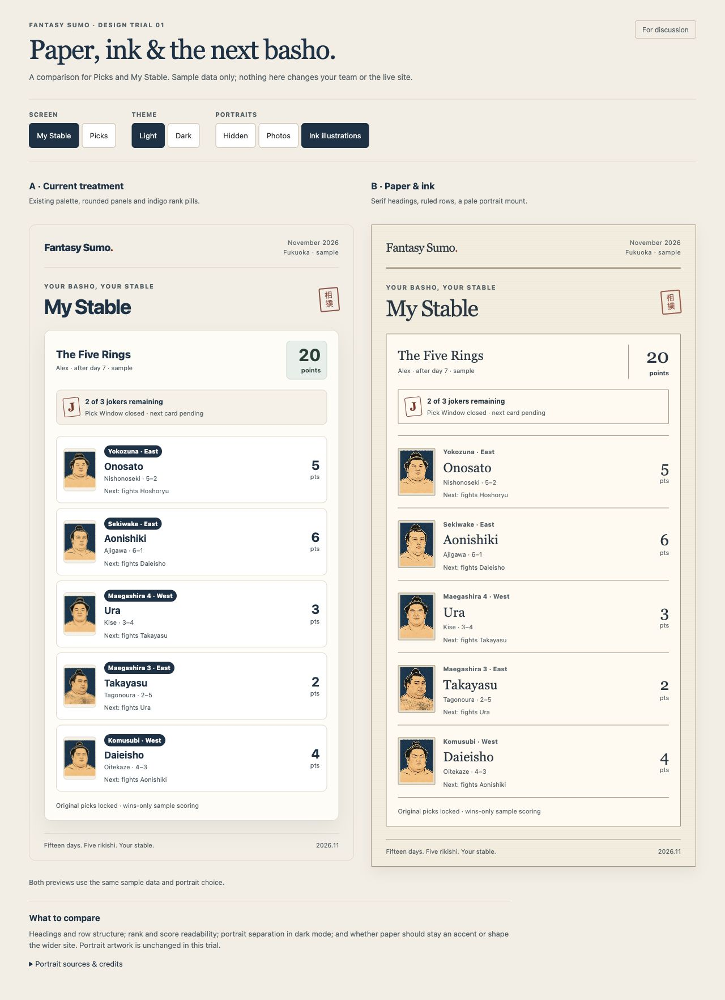
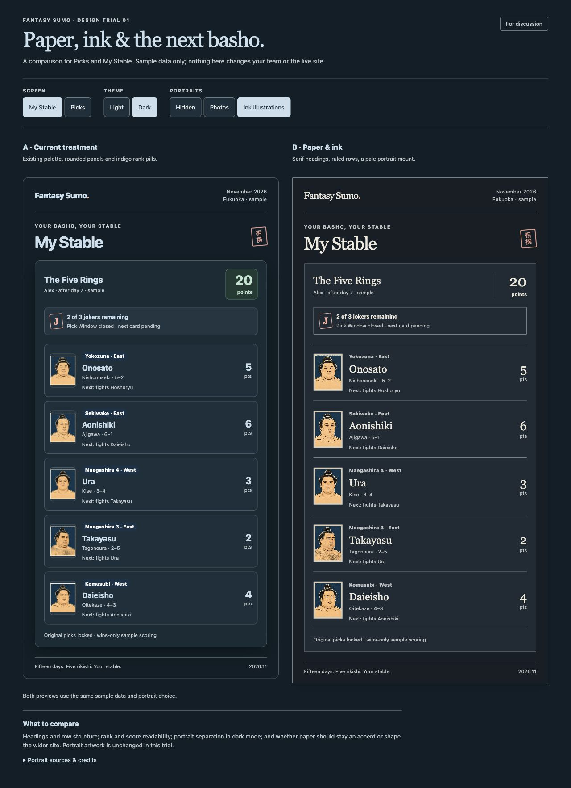

# Paper and ink visual trial

This is the review-only visual trial requested in #130. It does not adopt a
new site style. The production entry, routes, shared theme, API, database,
game rules, portrait preferences and owner-held UAT branch are unchanged.
Keep #130 open for the owner's scope decision.

## Open the comparison

From the repository root:

```sh
pnpm --filter @fantasy-sumo/web exec vite --host 127.0.0.1 --port 7870
```

Open `http://127.0.0.1:7870/paper-banzuke-trial.html`. No API server, sign-in,
database or seed/reset command is needed. Use the comparison controls to
switch between Picks and My Stable, light/dark and hidden/photo/ink portraits.
Sample picks mirror between the two panels, but are never saved. Refresh
resets the comparison. It does not read or write real display preferences.

The separate HTML entry is intentionally absent from Vite's production inputs.
Trial components are covered by the existing TypeScript/lint checks, but are
not imported by `main.tsx` or a production route. Do not add it to production
inputs or the app router as part of this trial.

## What is being compared

- **A: current treatment reference.** A compact reconstruction using the existing
  palette, sans-serif headings, rounded cards, rank pills and existing portrait
  fit. This is a design reference, not a pixel-identical screenshot or full
  reproduction of the live journey.
- **B: paper and ink proposal.** Serif display headings, a double-ruled masthead,
  quieter table-like rows, restrained vermilion, and a pale portrait mount to
  distinguish the indigo artwork from dark panels. The outer mount owns the
  frame shape. Illustration fit follows the slight enlargement explored in UAT;
  licensed photos keep their unaltered contain fit.

Both show identical synthetic records, ranks, opponents and scores. The five
stable rows sum to 20 wins-only sample points. They are not live November
standings or a source of tournament facts. Portraits reuse the existing local
catalog paths and show existing attribution. No external font, image fetch,
new image generation, provider, dependency or asset download is introduced.
Photographic attribution links are ordinary optional navigation.

## Review and next decision

### Captured comparisons

Light, desktop:



Dark, desktop:



[320px mobile Picks comparison, dark mode](design-trials/paper-banzuke-mobile-dark.jpg).

The captures use synthetic data. The live local comparison above also exposes
the other screen, theme and portrait choices.

### Decision

Review both screens at desktop and 320/390px mobile widths in light/dark,
with keyboard focus, portraits hidden and photos selected. Compare rank,
name and score readability, selection clarity, framing and dark-mode separation.
Try long content and browser zoom as part of any later adoption work.

Decide whether to keep the current treatment, adopt only the portrait mount,
or take the paper headings/rows further. No option is chosen by this trial.
Portrait likeness and a flatter illustration style remain separate artwork
follow-ups; this trial does not silently replace the approved portrait set.

The app game loop is unchanged. Validate the comparison's local interactions,
responsive layouts and rendered CSS, run `make check`, and obtain independent
review before handing over the trial. Any later application rollout needs the
owner's design decision, a focused PR and relevant game-loop E2E validation.

Recorded validation on 8 November 2026: `make check` passed (494 application
tests, 23 default Postgres-only skips, six pilot checks, lint/format/build);
the separate trial entry also built successfully. The normal production bundle
hashes stayed unchanged and excluded the trial. Browser checks covered 36
screen/theme/portrait/width combinations at 320, 390 and 1280px with no horizontal
overflow or broken portraits. Mirrored selection, the five-pick sample cap,
keyboard Enter and visible focus passed. A fresh load had no console errors.
Measured text contrast after the local link-color repair was at least 5.29:1
in light and 7.24:1 in dark; decorative texture is not included in that numeric
measurement. The live game-loop E2E was not rerun locally because no application
entry, API or game flow changed. CI still runs its normal application suite.
