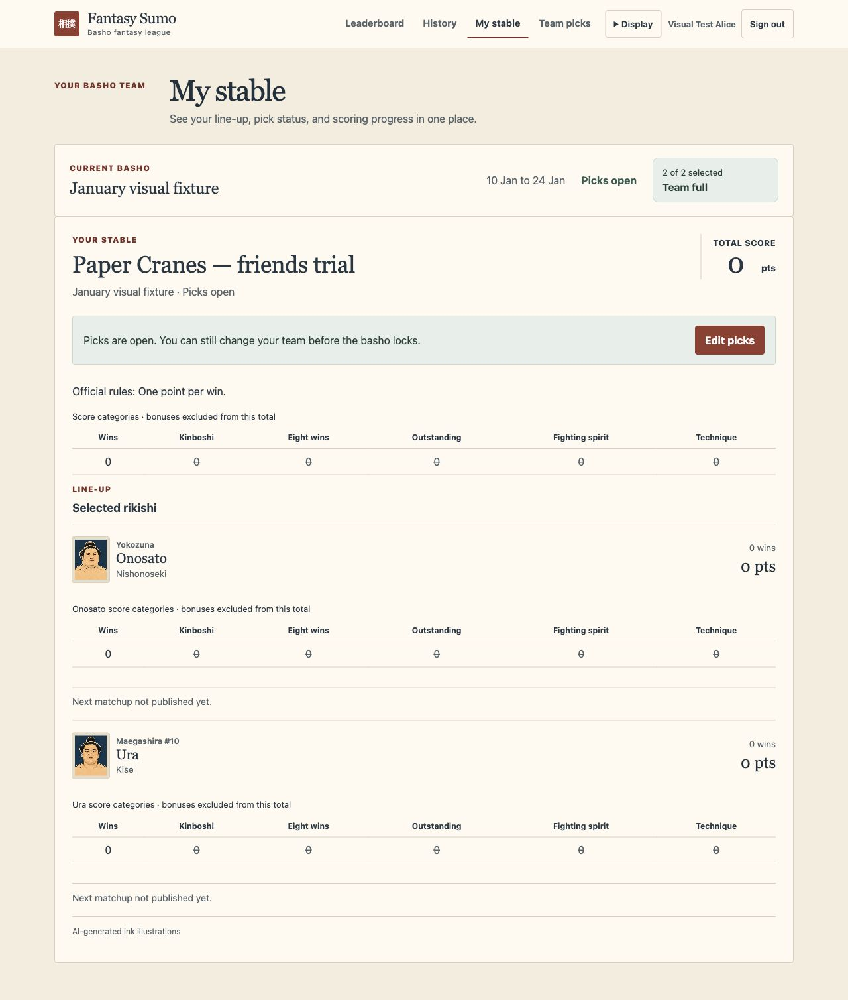

# Paper and ink application style

The owner chose the paper and ink direction from the #130 / PR #136 comparison
on 8 November 2026, for an initial rollout and feedback. The trial felt better
than the previous treatment, but some decorative framing felt like older web
design. This application slice keeps the paper palette, serif display headings,
ruled pick/stable rows and pale portrait mounts, with flat surfaces and light
single borders. It omits simulated paper texture, double rules and rotated
stamps. Body text, forms and navigation use the existing system sans-serif font.
No fonts or other assets are fetched from a new provider.

## Scope

- Shared light/dark colours and heading typography follow the selected direction.
- The header uses a paper surface and underlined active navigation instead of a
  dark bar with raised tabs. Session, role and mobile input behaviour are retained.
- Team picks and My Stable use simple row dividers, rank above the name, and
  existing selected/disabled/keyboard states. Names and scores remain prominent.
- Portrait frames use a pale mount in both themes, with one outside silhouette.
  Photos retain `contain` fit; existing ink illustrations retain their approved
  slight crop. Hidden / Photos / Ink illustrations remain an independent saved
  display choice. No portraits are replaced, regenerated or downloaded.
- History, leaderboard, account and admin screens inherit the shared palette
  and heading styles; their existing information layout and behaviour remain.
  The joker and final-title panels use the shared panel radius.

There is no theme-choice migration, API/model/scoring change, dependency, new
storage or change to defaults. System / Light / Dark still work before first
paint and retain the existing browser-local preference schema.

## Styling ownership

The header, navigation, selection and stable styles live in colocated
`.css.ts` modules. Their root class scopes the existing owned descendant/state
selectors while retaining familiar class hooks and responsive layouts. The
existing form controls, rank label and screen-reader-only selector serve
multiple components, so they live in the shared presentation compatibility
module instead of being an import side effect of TeamSelection.

`styles/theme.css.ts` owns the colour pairs, display font and paired portrait mount/foreground.
Document globals remain limited to document typography/background and shell.
Untouched component styles continue to use the same semantic tokens.

## Feedback and recovery

Gather feedback on readability, selected-pick clarity, portrait framing,
light/dark comfort and navigation on phones. This is an initial style choice,
not a commitment to imitate physical paper or redesign every interaction.

The application adoption is a separate focused commit/PR from the local
comparison. Revert that adoption commit in a follow-up PR if feedback calls for
it, run `make check` plus the browser game loop, and release through the existing
migration-gated GitHub workflow. There are no database or preference changes to
undo. Do not roll back to an old whole-app deployment that would discard later
unrelated fixes.

## Application previews

These captures use a disposable local fixture and existing catalogue portraits;
they are not live tournament standings.

[My Stable, 390px mobile dark mode](design/paper-ink/stable-mobile-dark.jpg).
