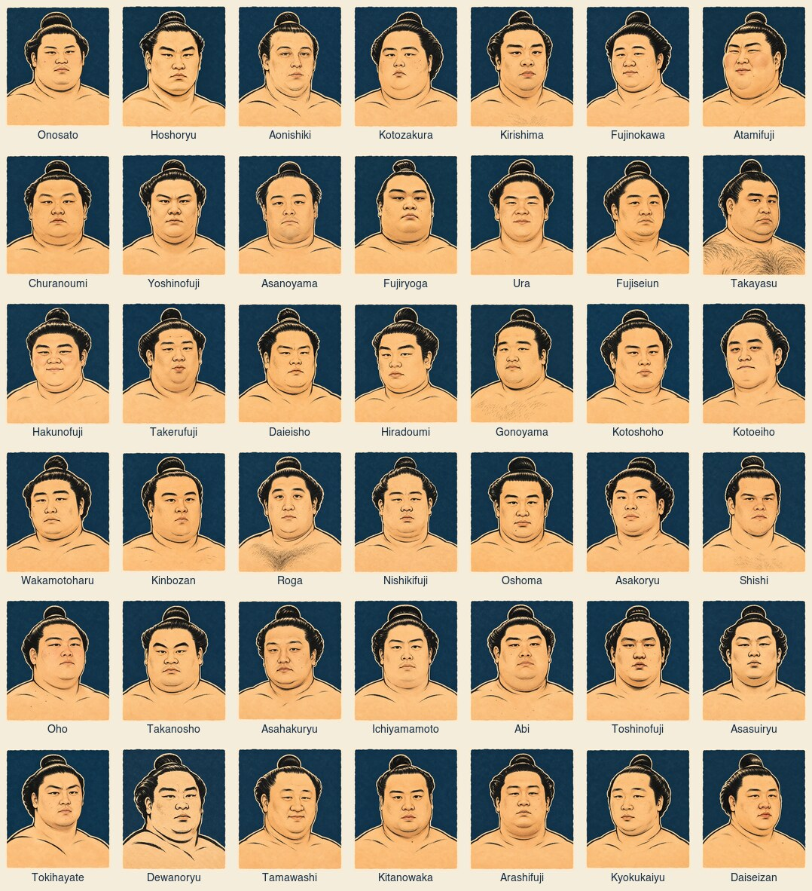

# Rikishi ink illustrations

The November 2026 Makuuchi set contains 42 individually generated portraits.
These are stylised likenesses, labelled **AI-generated ink illustrations** in
the app. They are independent of the licensed Commons photo collection.



## Assets and identity

The built-in image generation tool produced the artwork, using the approved
Dewanoryu illustration as the style reference and each wrestler's JSA profile
photograph as the identity reference. Identity was prioritised over the style
reference's face. The final selection was checked as a contact sheet for
individual faces, consistent framing, and the ink, washi and indigo treatment.

Runtime assets are 384 × 448 WebP files in
`apps/web/public/rikishi-illustrations/`. They retain the full composition and
load lazily from the same origin in the existing 48 × 56 frame. Filenames carry
the JSA ID and the first 12 hexadecimal characters of the file's SHA-256 hash.
The UI slightly enlarges illustrations (4%) inside the clipping portrait frame
to trim their baked-in paper edge. The frame controls the visible corner shape;
licensed photos retain their uncropped contain fit. The original artwork files
are preserved.
The API's `rikishi-illustration-catalog.ts` records both provider namespaces.
Only established aliases can resolve live artwork; unknown or conflicting
identities return no illustration. The deterministic demo has explicit
Onosato/Hoshoryu mappings and unmapped fallback rows.

Artwork remains tied to the person if their shikona changes. This is a curated
November roster set, not an automatic future-roster generator. Add portraits
for later promoted rikishi by verifying their provider identities, generating
and checking the new likeness, and adding a content-hashed asset and catalog
entry. No JSA source photographs are bundled with the application.

## Generation prompt

Mode: built-in image generation, one call per portrait. Reference 1 is the
individual identity photograph; reference 2 is the approved Dewanoryu artwork.
The prompt below was reused with the subject name and optional face-specific
cues; early outputs that copied the style reference's face were discarded.

```text
ONE head-and-shoulders portrait of {shikona}, the adult professional sumo wrestler in IMAGE 1. IDENTITY IS THE HIGHEST PRIORITY: accurately preserve IMAGE 1's specific facial geometry, age, eye spacing and shape, brows, nose, lips, chin, cheeks, complexion, facial hair and chonmage. IMAGE 2 is ONLY an art-technique/palette reference; borrow no facial features from its person. The subject's face must be distinct and recognizable as IMAGE 1. Recompose into a large centered bust with bare shoulders, both shoulders and the entire topknot in view. Japanese sumo-e woodblock/sumi ink, thick confident black contours, restrained simple hatchwork, warm ivory/ochre skin with minimal flat shading, subtle washi paper grain, flat deep indigo #183247 backdrop and thin ivory paper edge. Match IMAGE 2's palette, brushwork, paper, framing and image scale while using IMAGE 1's face. NO text, lettering, seals, signatures, logo, apron, UI, extra people or photorealism. Portrait aspect ratio 6:7, approximately 864x1008 pixels, legible at 48x56. {optional likeness cues from the identity photograph}
```

Dewanoryu uses the approved standalone artwork from the original mockup.
ImageMagick only resized and encoded the accepted artwork for the web build;
it was not used to draw or synthesize the portraits.

## Reference identities

These links document the identity references used during generation. JSA IDs
and Sumo API IDs are separate namespaces and must never be interchanged.

| Rikishi at generation | JSA profile                                                    | Sumo API ID |
| --------------------- | -------------------------------------------------------------- | ----------- |
| Onosato               | [4227](https://www.sumo.or.jp/EnSumoDataRikishi/profile/4227/) | 8850        |
| Hoshoryu              | [3842](https://www.sumo.or.jp/EnSumoDataRikishi/profile/3842/) | 19          |
| Aonishiki             | [4230](https://www.sumo.or.jp/EnSumoDataRikishi/profile/4230/) | 8854        |
| Kotozakura            | [3661](https://www.sumo.or.jp/EnSumoDataRikishi/profile/3661/) | 20          |
| Kirishima             | [3622](https://www.sumo.or.jp/EnSumoDataRikishi/profile/3622/) | 7           |
| Fujinokawa            | [4191](https://www.sumo.or.jp/EnSumoDataRikishi/profile/4191/) | 615         |
| Atamifuji             | [4055](https://www.sumo.or.jp/EnSumoDataRikishi/profile/4055/) | 74          |
| Churanoumi            | [3711](https://www.sumo.or.jp/EnSumoDataRikishi/profile/3711/) | 71          |
| Yoshinofuji           | [4279](https://www.sumo.or.jp/EnSumoDataRikishi/profile/4279/) | 8857        |
| Asanoyama             | [3682](https://www.sumo.or.jp/EnSumoDataRikishi/profile/3682/) | 2           |
| Fujiryoga             | [4336](https://www.sumo.or.jp/EnSumoDataRikishi/profile/4336/) | 9051        |
| Ura                   | [3616](https://www.sumo.or.jp/EnSumoDataRikishi/profile/3616/) | 28          |
| Fujiseiun             | [4093](https://www.sumo.or.jp/EnSumoDataRikishi/profile/4093/) | 82          |
| Takayasu              | [2775](https://www.sumo.or.jp/EnSumoDataRikishi/profile/2775/) | 44          |
| Hakunofuji            | [4187](https://www.sumo.or.jp/EnSumoDataRikishi/profile/4187/) | 3           |
| Takerufuji            | [4171](https://www.sumo.or.jp/EnSumoDataRikishi/profile/4171/) | 5           |
| Daieisho              | [3376](https://www.sumo.or.jp/EnSumoDataRikishi/profile/3376/) | 9           |
| Hiradoumi             | [3705](https://www.sumo.or.jp/EnSumoDataRikishi/profile/3705/) | 24          |
| Gonoyama              | [4079](https://www.sumo.or.jp/EnSumoDataRikishi/profile/4079/) | 56          |
| Kotoshoho             | [3840](https://www.sumo.or.jp/EnSumoDataRikishi/profile/3840/) | 8           |
| Kotoeiho              | [4120](https://www.sumo.or.jp/EnSumoDataRikishi/profile/4120/) | 112         |
| Wakamotoharu          | [3371](https://www.sumo.or.jp/EnSumoDataRikishi/profile/3371/) | 13          |
| Kinbozan              | [4112](https://www.sumo.or.jp/EnSumoDataRikishi/profile/4112/) | 50          |
| Roga                  | [3907](https://www.sumo.or.jp/EnSumoDataRikishi/profile/3907/) | 55          |
| Nishikifuji           | [3742](https://www.sumo.or.jp/EnSumoDataRikishi/profile/3742/) | 40          |
| Oshoma                | [4108](https://www.sumo.or.jp/EnSumoDataRikishi/profile/4108/) | 61          |
| Asakoryu              | [4101](https://www.sumo.or.jp/EnSumoDataRikishi/profile/4101/) | 164         |
| Shishi                | [3990](https://www.sumo.or.jp/EnSumoDataRikishi/profile/3990/) | 86          |
| Oho                   | [3844](https://www.sumo.or.jp/EnSumoDataRikishi/profile/3844/) | 41          |
| Takanosho             | [3265](https://www.sumo.or.jp/EnSumoDataRikishi/profile/3265/) | 37          |
| Asahakuryu            | [4175](https://www.sumo.or.jp/EnSumoDataRikishi/profile/4175/) | 607         |
| Ichiyamamoto          | [3753](https://www.sumo.or.jp/EnSumoDataRikishi/profile/3753/) | 11          |
| Abi                   | [3485](https://www.sumo.or.jp/EnSumoDataRikishi/profile/3485/) | 22          |
| Toshinofuji           | [4243](https://www.sumo.or.jp/EnSumoDataRikishi/profile/4243/) | 8866        |
| Asasuiryu             | [4285](https://www.sumo.or.jp/EnSumoDataRikishi/profile/4285/) | 8859        |
| Tokihayate            | [3933](https://www.sumo.or.jp/EnSumoDataRikishi/profile/3933/) | 83          |
| Dewanoryu             | [3983](https://www.sumo.or.jp/EnSumoDataRikishi/profile/3983/) | 135         |
| Tamawashi             | [2629](https://www.sumo.or.jp/EnSumoDataRikishi/profile/2629/) | 14          |
| Kitanowaka            | [3939](https://www.sumo.or.jp/EnSumoDataRikishi/profile/3939/) | 66          |
| Arashifuji            | [4267](https://www.sumo.or.jp/EnSumoDataRikishi/profile/4267/) | 8858        |
| Kyokukaiyu            | [4232](https://www.sumo.or.jp/EnSumoDataRikishi/profile/4232/) | 8855        |
| Daiseizan             | [4116](https://www.sumo.or.jp/EnSumoDataRikishi/profile/4116/) | 378         |

The wider site-style discussion and visual trial is tracked in
[issue #130](https://github.com/Phugsy/fantasySumo/issues/130).
